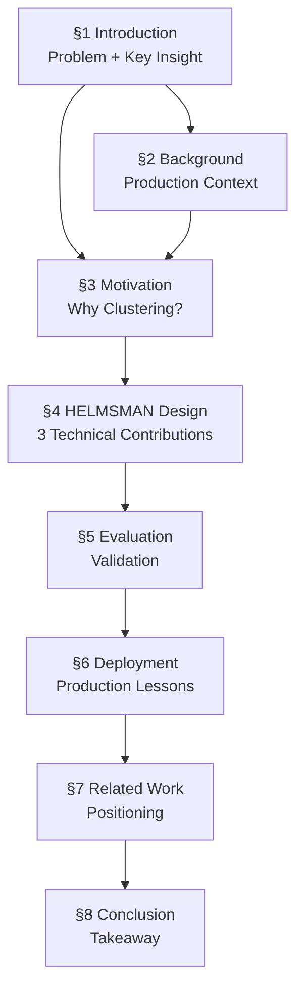

# HLS-L1 — Section Flow Chain Reconstruction

**Paper:** The Clustering Strikes Back: Building Cost-Effective and High-Performance ANNS at Scale with Helmsman
**Venue:** OSDI 2026

---

## Section Dependency Graph

---

## Section-by-Section Flow

### §1 Introduction
- **Purpose:** Establish the problem (PB-scale DRAM is unsustainable), introduce the counter-intuitive thesis (clustering-based ANNS can beat graph-based ANNS on modern SSDs), and preview the three design contributions.
- **A→B→C Chain:**
  - A: RedNote's ANNS infrastructure has scaled to PB-level DRAM → B: Exploring alternatives, graph-based DRAM-SSD designs fail because of serialized I/O → C: Clustering-based ANNS (SPANN) shows promise but has three deficiencies (low bandwidth utilization, fixed pruning, slow construction) → D: HELMSMAN's three techniques + production results (90% cost savings).
- **Figure refs:** None directly in Introduction, but references context from Figure 1 (workload characterization).

### §2 Background
- **Purpose:** Provide production context: characterize five ANNS-based services at RedNote (Search, Recommendation, Advertising, Content Moderation, RAG) and describe current two-tier solution (in-DRAM HNSW + hybrid DRAM-SSD graph).
- **A→B→C Chain:**
  - A: Five services have different characteristics along scale, SLA, top-k, and construction frequency → B: In-DRAM HNSW is used for strict SLAs (search, recommendation, advertising); hybrid DRAM-SSD graph (DiskANN/Starling/PipeANN) for relaxed SLAs (CM, RAG) → C: The key tension — in-DRAM is too expensive, hybrid graph is too slow for online SLAs.
- **Figure refs:** Figure 1 (4-panel characterization), Figure 2 (two solutions: in-DRAM graph vs. DRAM-SSD graph).
- **Dependencies:** None (self-contained background).

### §3 Motivation
- **Purpose:** Empirically demonstrate why in-DRAM is unsustainable (§3.1), why graph-based DRAM-SSD fails (§3.2), why clustering-based ANNS is promising (§3.3), and what specific challenges remain (§3.4).
- **A→B→C Chain:**
  - A: §3.1 — PB-level DRAM consumption, throughput overkill (only 32-43% utilized) → B: §3.2 — Graph-based DRAM-SSD systems (DiskANN, Starling, PipeANN) fail latency SLAs and have 10-25× throughput gap due to serialized I/O → C: §3.3 — Clustering-based SPANN with batched I/O nearly meets latency SLAs and scales throughput with SSD count → D: §3.4 — But SPANN still has 86-88% throughput gap (low bandwidth utilization), fixed pruning causes unstable recall, and construction takes days.
- **Figure refs:** Figure 3 (DRAM usage & throughput overkill), Figure 4 (graph-based DRAM-SSD failure: latency + throughput), Figure 5 (clustering-based layout), Figure 6 (SPANN promise: latency + scalability), Figure 7 (SPANN deficiencies: throughput gap, bandwidth, pruning, construction time), Table 1 (hardware price/bandwidth comparison).
- **Dependencies:** Builds on §2's characterization; sets up challenges that §4 solves.

### §4 HELMSMAN Design
- **Purpose:** Present the three core technical contributions that address the challenges identified in §3.4.
- **A→B→C Chain:**
  - A: §4.1 — Overview: three-stage online serving pipeline (router → centroids → pruning → batched I/O → compute) plus three-step offline construction (GPU coarse clustering → CPU balancing → merge + train) → B: §4.2 — ANNS-oriented storage stack: analyze I/O patterns (batched fixed-size reads, high IOPS demand), profile kernel overhead (58% from libaio), adopt SPDK with direct NVMe command submission, custom data layout (raw blocks for clusters, files for metadata) → C: §4.3 — Leveling-learned search pruning (LLSP): problem of fixed pruning, design of router + level-specific GBDT models using only pre-search features (query, top-k, centroid distances), offline training from sampled production logs → D: §4.4 — GPU-accelerated elastic construction: three-step pipeline, GPU for coarse k-means (Figure 13 speedup), elastic CPU workers with QoS preemption for fine-grained balancing, final merge.
- **Figure refs:** Figure 8 (design overview), Figure 9 (I/O stack profiling), Figure 10 (storage data layout), Figure 11 (pruning workflow), Figure 12 (construction pipeline), Figure 13 (GPU vs. CPU clustering speedup).
- **Dependencies:** Directly addresses challenges from §3.4; storage stack design informed by §3.4 bandwidth analysis; pruning design contrasts with §3.4 fixed pruning; construction design addresses §3.4 construction bottleneck.

### §5 Evaluation
- **Purpose:** Validate HELMSMAN's claims through comprehensive benchmarking on public and production datasets.
- **A→B→C Chain:**
  - A: §5.1 — Setup: 6 datasets (SIFT + 5 production), 5 baselines (HNSW, DiskANN, Starling, PipeANN, SPANN), hardware specs → B: §5.2 — Search performance: end-to-end throughput/latency vs. baselines across varying top-k and recall, comparison with in-DRAM HNSW deployments (25-85% throughput, meeting SLAs) → C: §5.3 — Storage I/O impact: bandwidth utilization (70-85% vs. 20-55%), gains from SSD hardware upgrades (55-87% vs. 10-40%) → D: §5.4 — Pruning efficiency: 1.1-1.6× throughput over no-pruning, >80% queries meet target recall (vs. <60% fixed), feature importance analysis → E: §5.5 — Construction: GPU acceleration (sub-hour for 0.1B), elastic scaling (4-7 hours for 10B) → F: §5.6 — Cost efficiency: 8.3× throughput-per-dollar for 10B, comparable offline construction cost.
- **Figure refs:** Figure 14 (throughput/latency vs. top-k and recall), Figure 15 (throughput vs. average latency trends), Figure 16 (throughput vs. P99.9 latency), Figure 17 (comparison with in-DRAM HNSW), Figure 18 (bandwidth utilization + upgrade gains), Figure 19 (pruning speedup), Figure 20 (search quality per-query), Figure 21 (construction acceleration), Table 2 (dataset statistics), Table 3 (feature importance), Table 4-5 (cost efficiency), Table 6 (construction cost).
- **Dependencies:** Validates all claims from §4; baselines from §2-3.

### §6 Deployment
- **Purpose:** Report production deployment status and share operational lessons learned.
- **A→B→C Chain:**
  - A: §6.1 — Deployment status: 40 all-flash servers replacing ~35,000 cores and ~0.35 PB DRAM, serving all five services → B: §6.2 — Operational lessons: (1) SSD die-level conflicts from query hotspots mitigated by redundant cluster copies (1.5-2× throughput improvement); (2) memory bandwidth becomes bottleneck before external I/O — 12-channel DDR5 at ~300-350 GB/s limits SSD utilization to ~70%; (3) large top-k is more important than extreme recall for multi-stage pipelines; (4) in-place updates remain challenging, current hybrid design (periodic rebuild + in-memory delta index).
- **Dependencies:** Real-world validation of §4-5 design; future work directions informed by operational experience.

### §7 Related Work
- **Purpose:** Position HELMSMAN within three research areas.
- **A→B→C Chain:**
  - A: DRAM-SSD ANNS — graph-based (DiskANN, Starling, PipeANN) vs. clustering-based (SPANN); argues modern SSD bandwidth favors clustering → B: Pruning for ANNS — early termination methods (Quake, Auncel, LAET) conflict with batched SSD I/O → C: Acceleration of index building — GPU-based k-means (CAGRA, RAFT, Faiss) and parallel graph construction (ParlayANN); HELMSMAN adapts these in its construction pipeline.
- **Dependencies:** Positions against works referenced throughout §1-6.

### §8 Conclusion
- **Purpose:** Summarize the core argument: for industrial workloads with large top-k, graph-based ANNS on SSDs is fundamentally limited by serialized I/O; clustering-based ANNS paired with high-bandwidth NVMe arrays and co-designed system software can approach in-DRAM performance at dramatically lower cost.
- **A→B→C Chain:** Single-paragraph restatement of motivation → approach → results.
- **Dependencies:** Synthesizes all prior sections.
