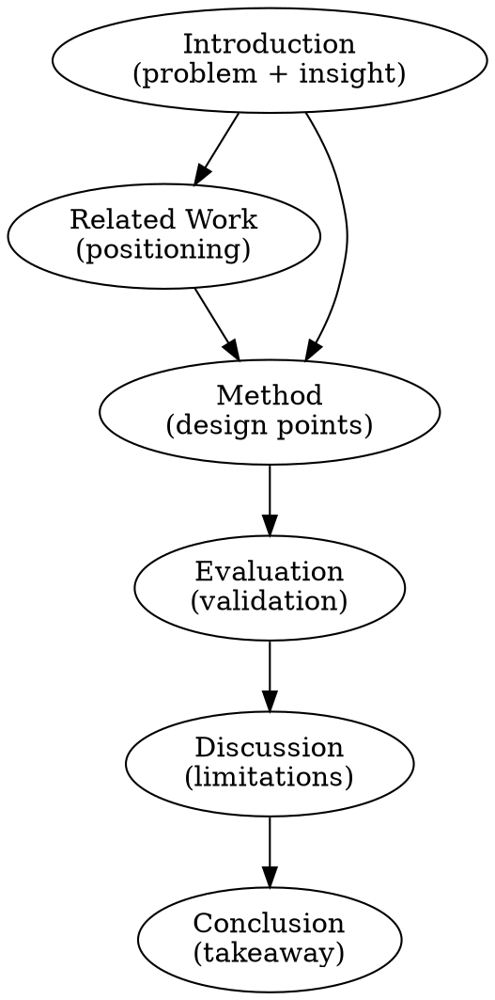

# Extraction Guide — Output Structure & Source Handling

**Load when:** executing E0 extraction or understanding the output layout.

## Output Structure

```
output/
  analysis/                    # Raw extraction artifacts (E0 + E3)
    full-text.md               # Complete text with section markers
    figures.md                 # Captions with page numbers, image refs, context
    figures/                   # Extracted figure images (PNG)
      fig-01.png
      fig-02.png
      ...
    references.md              # Reference list
    metadata.json              # Title, authors, abstract
    structure.json             # Section tree (LaTeX only)
    critical-assessment.md     # E3 output
  results/                     # HLS analysis (E1 → E2)
    hls-L0.md                  # Full 7+1 core points with evidence citations
    hls-L1.md                  # Section flow chain reconstruction
    tldr.md                    # Condensed L0 — see references/tldr-format.md
```

## PDF Extraction

**Command:** `scripts/extract-pdf.py <paper.pdf> --output output`

Creates `output/analysis/` with:
- `full-text.md` — full text with `<!-- PAGE N -->` markers and `## Section` headers auto-detected
- `figures.md` — each figure/table with caption, page number, inline image preview, and collapsible surrounding context
- `figures/` — high-resolution (200 DPI) page renders cropped to figure regions
- `references.md` — bibliography entries split by `[N]` markers
- `metadata.json` — detected title and abstract

**Figure extraction strategy:**
1. Render each PDF page as 200 DPI PNG via pdfplumber + Pillow
2. Locate figures by matching captions to page text
3. Single-figure pages: save full page; multi-figure pages: split vertically
4. Caption context: capture 2-3 paragraphs surrounding each figure

**Dependencies:** `pip install PyPDF2 pdfplumber Pillow`

**Fallback (no Pillow):** figure images skipped; captions and context still extracted. Agent should manually screenshot figures from PDF.

**Fallback (scanned PDF):** use `pdftotext` or similar OCR tool. Agent reads PDF directly and manually extracts text by section.

## LaTeX Extraction

**Command:** `scripts/extract-latex.py <main.tex> --output output`

Creates `output/analysis/` with:
- `full-text.md` — cleaned text with `## Section` headers, abstract, and author block
- `figures.md` — each figure/table with caption, `\includegraphics` source paths, and collapsible surrounding context
- `references.md` — all `\cite` keys sorted alphabetically
- `metadata.json` — title, authors parsed from `\title{}` and `\author{}`
- `structure.json` — section/subsection hierarchy with depths

**Figure context strategy:**
1. Parse complete `\begin{figure}...\end{figure}` and `\begin{table}...\end{table}` environments
2. Extract `\caption{}` text and `\includegraphics{}` source file paths
3. Capture 2-3 paragraphs immediately before and after each environment
4. Context is command-stripped for readability

**Dependencies:** stdlib only (no pip installs needed)

**Auto-resolve:** `\input{}` and `\include{}` directives are recursively resolved.

## E2: Section Dependency Graph

Reconstruct the paper's narrative architecture into `output/results/hls-L1.md`. For each Section: name, purpose, A→B→C flow chain, figure references to `output/analysis/figures/`, and dependencies.

Typical dependency structure:



## Critical Assessment Dimensions (E3)

Output to `output/analysis/critical-assessment.md`. Four required dimensions:

### Innovation Level
| Level | Criteria |
|-------|----------|
| **Breakthrough** | New problem + new solution paradigm |
| **Novel** | Known problem + fundamentally new approach |
| **Incremental** | Known approach + component improvement |
| **Engineering** | Known approach + system building |

### Strengths (3+)
Technical depth, evaluation rigor, clarity, novelty, practical impact.

### Weaknesses (3+)
Missing ablations, weak baselines, narrow evaluation, unsubstantiated claims, missing related work.

### Gap Analysis
What does this paper NOT solve? What assumptions constrain generalizability?

### Positioning Map
2D comparison of this paper vs. 3-5 closest prior works. X-axis: approach type. Y-axis: scope.
