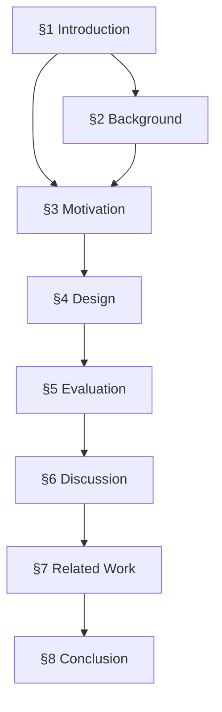

## Section Dependency Graph

## Section-by-Section Flow

### §1 Introduction
- **Purpose:** [why this section exists]
- **A→B→C Chain:**
  - A: [setup] → B: [argument] → C: [thesis]
- **Figure refs:** [fig-XX]

### §2 Background
- **Purpose:** [why this section exists]
- **A→B→C Chain:**
  - A: [setup] → B: [argument] → C: [transition]
- **Figure refs:** [fig-XX]
- **Dependencies:** [prior sections]

<!-- Repeat for each section -->
