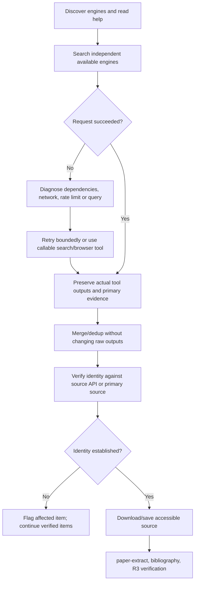

# Systematic Research

Retrieve real sources, preserve provenance, and apply `paper-extract` to accessible
material. Never generate catalog metadata or paper claims from memory.

## R0: Retrieval and identity

1. List `scripts/search-*.py` and `search-engines/`; read matching engines' help.
   Pair domain and general engines where available. Do not send a free-text topic
   to a conference-listing engine. Use separate output directories for each run.
2. Install optional dependencies only when needed. Read
   [retrieval-and-failures](references/retrieval-and-failures.md) for setup,
   USENIX syntax, output contracts, retries and callable-tool fallback.
3. Inspect exit status. Failure is not zero hits. Nonzero invocations write
   `search-error.json`; successful invocations include `status: success` and count.
   Do not merge stale results left by failed invocations.
4. Preserve raw script/tool outputs. Merge and dedup by URL/DOI without inventing
   entries or fields. Each field must trace to a retrieved response.
5. Verify title, available authors and abstract against source API/primary source.
   Compare up to the first three authors, allowing fewer-author papers. Preserve
   the response, method and discrepancies. API failures are not matches.
6. The bundled verifier supports arXiv only. Run it on a COPY, retaining raw
   input. DOI/OpenAlex/web items use saved source responses and verification
   records; never send unrelated identifiers to the arXiv API.
7. Download or save actual PDF/HTML content before extraction. A search snippet
   cannot support design or evaluation claims. Flag abstracts-only access.

<HARD-GATE-IDENTITY>
Unresolved identity mismatches block the affected item. Continue independently
verified items; report unavailable sources and incomplete coverage. Never
fabricate missing metadata or source files to satisfy a gate.
</HARD-GATE-IDENTITY>

## E: Source extraction

Discover the sibling `paper-extract` skill and recursively list its templates and
references. Read its `SKILL.md`; follow E0, E1, E1.5 and E2 as requested. Do not
assume a template path. Record claims with actual sections/pages and distinguish
source claims from proposed designs or hypotheses.

Each knowledge item contains actual source material, `tldr.md`, `l0.md`, `l1.md`
when required, and `bibentry.bib`. Use `bibtexparser`; citation metadata must trace
to retrieval/verification evidence. Aggregate with `collect-bib.py` as needed.

## R3: Completion

Run `verify-results.py` on the knowledge subtree and retain its output. Check
source existence, required extraction files, citation URL/DOI and author identity.
Spot-check 2–3 decompositions against their sources for system names, claims and
section evidence. Correct errors before declaring the library complete.

<HARD-GATE-COMPLETE>
Exploratory discussion may proceed from accessible primary evidence while the
library is incomplete. Label facts, inferences, proposals and untested goals.
Do not claim a complete systematic review, exhaustive search, or passed R3 until
its required source, extraction and bibliography checks actually pass.
</HARD-GATE-COMPLETE>
