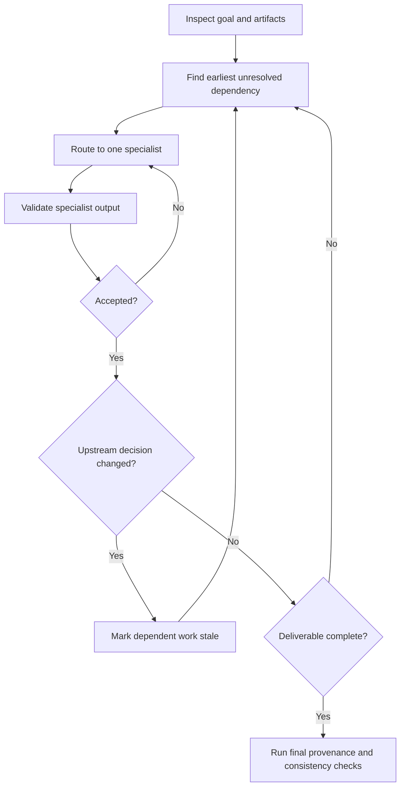

# Systematic Research

Inspect the research state, choose the earliest unresolved dependency, and route it
to one specialist. Preserve source provenance and recheck downstream work whenever
evidence, claims, structure, or venue changes.

<HARD-GATE>
Never fabricate sources, metadata, claims, results, or completed checks. Do not let
multiple specialists redefine the same upstream decision. Do not declare completion
while identity, evidence, or a blocking review finding remains unresolved.
</HARD-GATE>

## Inspect

Read available sources, notes, plans, drafts, figures, reviews, and slides before
asking questions. Record the requested deliverable, current blocker, known evidence,
accepted decisions, stale outputs, and unresolved risks. For multi-stage work, keep
one checkpoint in the research project, never in the installed skill directory.
Read the [orchestration contract](references/orchestration-contract.md) for the
default dependency order, decision ownership, checkpoint fields, and invalidation.

## Route

Choose the earliest unresolved dependency. Read the selected sibling skill's full
`SKILL.md` before acting and obey its gates.

| Need | Specialist |
|---|---|
| Discover and verify real web or academic sources | Follow [retrieval workflow](references/retrieval-workflow.md) |
| Extract claims, structure, and evidence from sources | `paper-extract` |
| Define contributions, structure, draft, revise, or audit a paper | `paper-writing` |
| Simulate independent reviewers and resolve findings | `paper-review` |
| Design or produce an academic figure | `paper-plot` |
| Compare a generated figure with a reference and improve principles | `analyze-plot` |
| Build an evidence-led academic slide deck | `academic-pptx-skill` |

If evidence is insufficient, retrieve and extract before writing claims. If a review
finding challenges the contribution, repair the earliest responsible writing layer
instead of softening surface prose. Generate result figures only from real results.

## Reconcile

After each specialist finishes, record its output, validation result, dependencies,
and next action. When evidence, core claims, venue, or paper structure changes, mark
dependent prose, figures, reviews, and slides stale and revalidate them in dependency
order. Parallelize only independent source reads, reviews, or disjoint artifacts.

## Complete

Before delivery:

1. verify source identity and retain retrieval evidence;
2. distinguish source facts, inferences, proposals, and untested goals;
3. resolve or visibly report blocking review findings and unavailable evidence;
4. confirm current claims and structure are reflected in prose, figures, and slides;
5. run each selected specialist's completion checks.

Exploratory work may continue with incomplete evidence when labeled. Never claim an
exhaustive review, complete evidence base, or passed verification without its required
source artifacts and checks.
